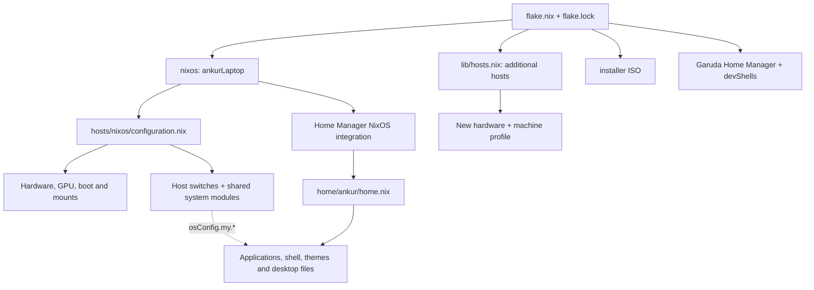

# Ankur's modular NixOS configuration

A flake-pinned NixOS system, an integrated Home Manager desktop, isolated developer
shells, a separate Garuda Home Manager output, and an independent installer ISO.
The original machine is exported as **`nixos`**, with user **`ankur`**.
**Do not install that host on a different computer:** it contains real disk UUIDs,
AMD/NVIDIA PCI addresses, and personal paths.

Start with the [documentation index](docs/README.md). The
[verification report](docs/AUDIT_REPORT.md) distinguishes automated checks from
builds and physical installation tests that could not run in the audit environment.

## What declarative configuration means

Nix expressions describe the desired system. NixOS evaluates modules, resolves
options, builds packages and generated files in `/nix/store`, then activates a
system generation. Editing a `.nix` file does nothing to the running machine until
you rebuild and activate it. This does not back up your browser profile, projects,
passwords, or other mutable data.

A **flake** gives a project named inputs and outputs. [`flake.nix`](flake.nix)
declares Nixpkgs, Home Manager, Nixvim and editor sources, and exposes:

| Output | Meaning |
| --- | --- |
| `nixosConfigurations.nixos` | Existing AMD + NVIDIA laptop, including Home Manager |
| `nixosConfigurations.ankur-installer-iso` | Independent minimal live ISO; no laptop mounts or personal home |
| `nixosConfigurations.<new-host>` | Additional directories discovered by [`lib/hosts.nix`](lib/hosts.nix) |
| `homeConfigurations."ankur@garuda"` | Separate, currently minimal standalone Home Manager configuration |
| `devShells.x86_64-linux.*` | `default`, `cpp`, `python`, `rust`, `node`; others controlled by host settings |

[`flake.lock`](flake.lock) records exact revisions and content hashes, including
transitive inputs. Nixpkgs is additionally revision-pinned in `flake.nix` at
`7fc6f2c20af09cdcaf48b92ec3121860139ec668`. `nix flake update` does not move that
explicit pin. Nixvim currently has its own locked Nixpkgs input; do not silently
change its `follows` relationship during routine maintenance.

## Architecture



There are two module systems. **NixOS** controls system services, boot, devices,
users, security integration and system packages. **Home Manager** controls a user's
packages, generated home files, user services and program settings. Home Manager
is imported as a NixOS module for the laptop, so `nh os switch` also activates its
home configuration. Do not separately run `home-manager switch` for that output.

The laptop imports pairs such as `hosts/nixos/power-battery.nix` (host choices) and
`modules/system/power-battery.nix` (option declarations and implementation). It
imports `modules/applications/options.nix` for most `my.apps.*` declarations;
additional browser, media, gaming and social declarations live in host files.
Home Manager reads resolved NixOS values through **`osConfig`**.

Example: `my.apps.desktop.kitty.enable` in
[`hosts/nixos/applications.nix`](hosts/nixos/applications.nix), together with its
category switch, adds `pkgs.kitty` through `home/ankur/applications/desktop.nix`
and generates `~/.config/kitty/kitty.conf` through `home/ankur/hyprland/kitty.nix`.
It does **not** enable Home Manager's `programs.kitty`. A package can be managed
by Home Manager without using a dedicated `programs.<name>` module.

Options merge across all imports; files are not executed in import order.
Lists normally concatenate. Conflicting equally ranked scalar values fail.
`lib.mkIf` makes definitions conditional; `mkDefault` has lower precedence than a
normal assignment; `mkForce` has higher precedence. See the
[architecture and complete module reference](docs/ARCHITECTURE.md) and
[module tutorial](docs/MODULE_MANAGEMENT.md).

## Repository map

| Path | Responsibility |
| --- | --- |
| `hosts/nixos/` | Original laptop's hardware and selected feature settings |
| `modules/system/` | Shared option declarations, services and diagnostic helpers |
| `modules/applications/` | Application option schema and privileged Docker integration |
| `modules/hardware/nvidia-hybrid.nix` | Opt-in AMD/Intel + NVIDIA PRIME offloading |
| `modules/profiles/{portable,machine}.nix` | Small reusable profiles for additional computers |
| `home/ankur/` | Personal Home Manager root, application lists, themes, shell and desktop |
| `home/ankur/hyprland/` | Lua compositor config, Waybar, Kitty, Wofi, Mako, lock/idle and menus |
| `modules/development/` | Language dev shells and `nix-dev` helper |
| `hosts/garuda/`, `modules/home/` | Standalone Garuda HM output; currently mostly placeholders |
| `hosts/installer-iso/`, `modules/iso/` | Independent ISO and selectable live tools |
| `hosts/templates/`, `lib/hosts.nix` | Additional-host instructions and automatic registration |
| `scripts/` | General installer, host generator, checks and original-laptop reinstall tools |
| `tests/` | Installer safety tests and Nix evaluation fixtures |
| `assets/` | SDDM background; cursor/Kvantum assets are under `home/ankur/themes/` |
| `docs/` | Indexed specialist guides, architecture, commands and audit evidence |

The [full configuration file tree](docs/REPOSITORY_TREE.md) includes every Nix
module, script and guide. The module reference gives dependencies, conflicts,
activation switches and verification commands.

## Change software on the original laptop

```bash
cd ~/nixos-config
# Edit hosts/nixos/applications.nix, for example utilities.kate.enable = true.
git add hosts/nixos/applications.nix
nh os build . -H nixos
nh os test . -H nixos
nh os switch . -H nixos
git diff --cached --check
git commit -m "Enable Kate"
git push origin main
```

`test` activates immediately without selecting the next boot generation;
`switch` activates and updates the boot default; `boot` changes only the next boot
selection. Use `nh os boot . -H nixos` for a change you want to activate at reboot.
A failed activation can leave services partly changed; inspect `systemctl --failed`.
New files must be **Git-added** before Git-backed flakes see them. Modified tracked
files are visible without committing; a commit records a reproducible checkpoint.

To remove Kate, change the switch to `false` and rebuild. To disable the entire
utilities group, set `my.apps.utilities.enable = false`. Another package list can
still install the same software: search with `rg 'kate|kdePackages.kate' hosts modules home`.
Vivaldi has switches in **both** `internet` and `browsers`; MPV/OBS in **both**
`multimedia` and `media`; Signal in **both** `internet` and `social`. Disable every
active provider. Nixvim may supply tools such as Git, curl, ripgrep and language
servers even when the corresponding global application switch is off.

Removing a package does not delete its user data, and another retained generation
may keep its store closure. Do not manually delete store files. The
[module tutorial](docs/MODULE_MANAGEMENT.md) covers system/user packages,
temporary packages, services, optional imports and creating your own module.

## Desktop, Garuda features and games

The original desktop is Hyprland with UWSM and SDDM. Plasma is explicitly disabled
by `kde-cleanup.nix`, despite its earlier `true` assignment in `configuration.nix`.
The final SDDM theme is forced to `sddm-astronaut-theme`; the older Elegant theme
module is still imported but its theme value loses to that override.

Waybar's generated config filters application components and inserts power-profile
controls before the battery. Fish syntax colors, Starship/Fastfetch, Sweet GTK/Qt
assets and the personal Kitty palette have separate owners. The
[desktop guide](docs/DESKTOP_AND_HOME_MANAGER.md) explains the exact files.

[Garuda-inspired features](docs/GARUDA_GOODIES_ON_NIXOS.md) use native NixOS
services: power-profiles-daemon, irqbalance, Ananicy C++, GameMode, fstrim and ZRAM.
The host's effective intended ZRAM size is **90% logical RAM**, overriding a 50%
`mkDefault`; compression is Zstandard and `vm.swappiness` is 180. Monthly Btrfs
scrub covers `/` once, excluding the separate `/mnt/garuda` filesystem. These are
configuration facts, not measured performance improvements.

For the existing hybrid laptop, Steam launch options can be:

```bash
nvidia-offload gamemoderun %command%
```

`%command%` is a **Steam placeholder**, never a literal terminal command. From a
terminal, use `nvidia-offload gamemoderun your-game`. GPU selection and GameMode
are separate operations. Verify with `gamemoded -t`, `gamemoded -s` during a game,
and `nvidia-smi`. The [gaming/GPU guide](docs/GAMING_AND_GRAPHICS.md) includes Intel,
AMD, hybrid NVIDIA and NVIDIA-only configurations.

## Install on a new computer

Read the [complete installation guide](docs/INSTALLATION.md) **before disk changes**.
Use an official x86_64 NixOS live USB. Back up other operating systems and personal
data. Prepare and mount the intended partitions manually, or use fresh mode on an
already empty Btrfs filesystem. The general installer never formats or repartitions.

```bash
nix-shell -p git python3
git clone https://github.com/AnkurAlpha/My-personal-nix-config.git
cd My-personal-nix-config
sudo env "PATH=$PATH" bash scripts/install.sh --host newpc --username alice --graphics amd --desktop hyprland
# The command above is a plan. After reviewing it, repeat with --install.
sudo env "PATH=$PATH" bash scripts/install.sh --host newpc --username alice --graphics amd --desktop hyprland --install
```

Default mode expects a writable target root at `/mnt`, and for UEFI an ESP at
`/mnt/boot`. Existing OS roots, unknown occupied target paths and shared ESPs are
refused by default. Shared ESP use needs explicit opt-in and a local confirmation;
bootloader fallback files can change. Legacy GRUB additionally needs a chosen whole
disk and explicit boot-code replacement confirmation. Secure Boot, unsupported
architectures and complex storage layouts require manual preparation/review.

The installer generates fresh hardware configuration, creates a **new** host,
evaluates assertions, builds it, installs it and prompts for passwords locally.
It does not overwrite the original laptop configuration or copy private keys.
It creates `/etc/nixos-config` on the installed target. New profiles offer either
minimal TTY or a small Hyprland session; they deliberately do not reproduce all of
Ankur's personal desktop. Add shared modules after checking their dependencies.

For host generation without installing, see [multi-host management](docs/HOSTS.md).
For this **original laptop only**, retain the separate
[Btrfs reinstall workflow](docs/NIXOS_BTRFS_REINSTALL.md).

## Generations, recovery and maintenance

A generation points to an immutable system closure in the Nix store. Bootloader
entries select generations; `/run/current-system` points to the active system.
Roll back a bad configuration with `sudo nixos-rebuild switch --rollback`, or select
an older generation at boot if the current system cannot start. Revert the source
change too, otherwise the next rebuild recreates it. Rollback does not reverse
user-data edits or database schema migrations.

```bash
systemctl --failed
journalctl -b -u display-manager --no-pager
nix eval --raw .#nixosConfigurations.nixos.config.networking.hostName
nix eval --json .#nixosConfigurations.nixos.config.hardware.nvidia.prime.offload.enable
nix flake check --no-build --no-update-lock-file
bash scripts/check.sh
```

[Commands and recovery](docs/COMMANDS.md) explains evaluation, builds, service
restarts, Git, store inspection, comparisons and cleanup. Deleting old generations
or GC roots can remove rollback paths and dev-shell caches. `nh clean` is a
maintenance action to review explicitly, not an installation step. Btrfs scrub
checks checksums; it does not provide snapshots or backups.
