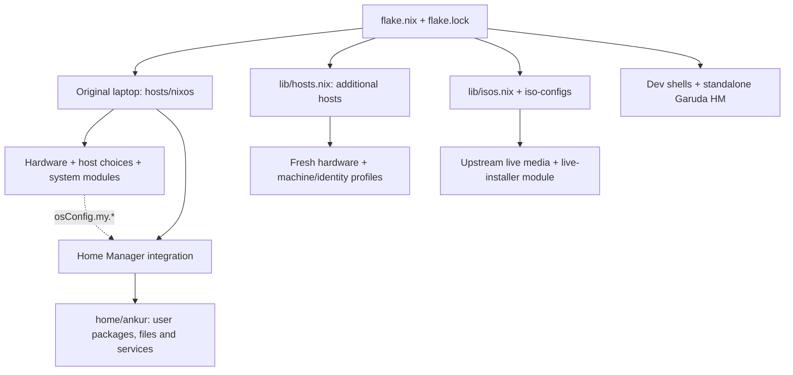

# Modular NixOS: the single manual

One repository for the existing `nixos` laptop, additional computers, reproducible
development shells, and minimal or Hyprland live ISOs. All maintained instructions
are in **this README**. Earlier guides were consolidated and removed; Git history
retains their previous versions.

The existing laptop keeps its **ankur** account. New computers and custom live
ISOs choose their own usernames; they do not inherit it automatically. Passwords
are entered locally during live boot or installation, never saved in Git or baked
into an ISO. A live ISO is an installer environment, not a backup of your SSD.

- [Build your own ISO](#build-your-own-iso)
- [Install from either kind of USB](#install-from-either-kind-of-usb)
- [Accounts and additional computers](#accounts-and-additional-computers)
- [Architecture and module reference](#architecture-and-module-reference)
- [Manage applications and modules](#manage-applications-and-modules)
- [Desktop and Home Manager](#desktop-and-home-manager)
- [Gaming and graphics](#gaming-and-graphics)
- [Power, storage and maintenance](#power-storage-and-maintenance)
- [Commands, updates and recovery](#commands-updates-and-recovery)
- [Troubleshooting](#troubleshooting)
- [Validation and current limits](#validation-and-current-limits)

## Build your own ISO

### Choose a live account and desktop

On your installed NixOS system, run as your **normal user**, without sudo:

```bash
cd ~/nixos-config
bash scripts/build-iso.sh
```

The wizard validates each answer immediately and lets you retry invalid choices.
For example:

| Prompt | Example answer | Meaning |
| --- | --- | --- |
| ISO configuration name | `my_iso` | Saves `iso-configs/my_iso.nix`; exports `iso-my_iso` |
| Live username | `garuda` | Account used in this live session; independent of the image name |
| Desktop | `hyprland` or `1` | Graphical live desktop; `minimal` or `2` gives a terminal only |

Profile names accept 1-63 lowercase letters, digits, hyphens and **underscores**;
start with a letter, end with a letter/digit, and omit the reserved `iso-` prefix.
Live usernames follow regular-account rules: start with a lowercase letter or
underscore, use lowercase letters/digits/underscores/hyphens, at most 31 characters;
`root`, `nobody` and `daemon` are reserved. `garuda` is a valid username.
**Garuda is a Linux distribution, not a desktop option.** These images run NixOS;
select `hyprland` for the graphical profile described below. Press Enter to keep a
prompt's default; desktop names are case-insensitive in the wizard. Ctrl+C or end
of input cancels cleanly. Explicit command-line flags remain strict and fail on
invalid input rather than requesting replacements.

The helper creates a public `iso-configs/NAME.nix`, stages it so
Nix can see it, builds the ISO, copies a real `.iso` into `~/ISO`, and writes its
`.iso.sha256` checksum. It retains the Nix result link as well. Unrelated source
changes must be committed or safely saved first. It never flashes a USB, activates
a system, changes partitions, or pushes Git commits.

Explicit alternatives:

```bash
# List existing image configurations; no build/download.
bash scripts/build-iso.sh --list
# Build a built-in profile; neutral live username is nixos.
bash scripts/build-iso.sh --profile minimal
bash scripts/build-iso.sh --profile hyprland
# Create a distinct public profile with your chosen live account, then build.
bash scripts/build-iso.sh --name travel --username alice --desktop hyprland
# The choices in the table above, without prompts.
bash scripts/build-iso.sh --name my_iso --username garuda --desktop hyprland
# Preview without writes, Git staging or build.
bash scripts/build-iso.sh --name travel --username alice --desktop hyprland --dry-run
# Write/stage preferences only; review/commit before building this saved profile.
bash scripts/build-iso.sh --name travel --username alice --desktop hyprland --configure-only
git add iso-configs/travel.nix
git commit -m "Add travel live ISO profile"
bash scripts/build-iso.sh --profile travel --output-dir "$HOME/ISO"
```

Existing different profile files are not overwritten: choose a new name or edit
the existing file deliberately. Build outputs must be outside the repository and
protected system/mounted Garuda paths. ISO creation can download/build several GB;
check free space on `/nix` and the output filesystem. The real ISO copy uses
additional space beyond the Nix store. Keep the result symlink if you want its
store closure protected from garbage collection; the independent ISO copy remains
a normal file even if you later remove that link.

The public profile format is deliberately small:

```nix
{ ... }: {
  my.iso = {
    liveUsername = "alice";
    desktop = "hyprland";
  };
}
```

[`lib/isos.nix`](lib/isos.nix) exports each file as
`nixosConfigurations.iso-NAME`. The direct build equivalent is:

```bash
nix build --no-update-lock-file --out-link "$HOME/ISO/travel-result" \
  .#nixosConfigurations.iso-travel.config.system.build.isoImage
```

That direct command produces a Nix result link rather than the helper's extra
real ISO/checksum copy. `nix-fleet iso-build` delegates to the same wizard;
`nix-fleet iso-build --profile minimal` builds an existing profile. The historical
`ankur-installer-iso` output remains an alias for `iso-minimal` to preserve old
commands; it does **not** create an Ankur account.

### Boot and password setup

Write the resulting ISO to a verified USB using a trusted image writer. Confirm
the exact USB device in its UI; this repository supplies no automatic flashing or
formatting command. Keep backups and recovery media for other operating systems.

On every custom-ISO boot, the local console asks you to set the selected live
account's password **before login or the graphical greeter starts**. It is used
only for that live session and sudo. The live filesystem is temporary, so choose
it again after reboot. Root login is locked, SSH is off, and sudo requires the
live user's password. The console setup must complete before other login units.

| Stage | Username choice | Password choice / persistence |
| --- | --- | --- |
| Build a custom ISO | Wizard or `--username`; public `my.iso.liveUsername` preference | No password collected/stored at build time |
| Boot that ISO | Uses its selected live account | `passwd` prompts locally before login; RAM-backed live session only |
| Install from custom ISO | Installation wizard asks for the target username | Separate local target `passwd` prompt after successful installation |
| Install from official NixOS USB | Same installation wizard / `--username` | Same target password prompt; no automatic Ankur choice |

This is intentional: embedding a reusable password or hash would expose it to
anyone holding the image/Nix store. Password setup does not require adding a
secret to configuration or typing it in command arguments.

Minimal profile gives a TTY. Hyprland profile includes SDDM, PipeWire, Kitty,
Wofi and a small generic Waybar. Super+Enter opens a terminal, Super+D the launcher,
Super+Q closes a window, Super+1..0 selects workspaces. The live image uses generic
graphics support; unusual or NVIDIA-only hardware may need a separately reviewed
driver configuration. Neither profile imports the laptop's disk UUIDs, PRIME bus
IDs, fixed Wi-Fi interface, personal home, browser profiles, keys or passwords.
It contains the **public repository source** and installation tools. It is not an
offline copy of every package needed for every possible target; internet access
is required by the installation workflow and may be needed for Nix inputs/packages.

## Install from either kind of USB

### Custom ISO

After its live password setup and login:

```bash
nmtui                     # connect if necessary
lsblk -o NAME,PATH,SIZE,MODEL,FSTYPE,LABEL,UUID,MOUNTPOINTS
nixos-setup               # interactive choices, read-only plan by default
# After preparing/mounting the intended target filesystems:
nixos-setup --install
```

`nixos-setup` makes a writable, committed snapshot of the bundled source in a
new temporary directory, requests sudo, and invokes the same universal installer
used on official media. It asks for hostname, installed username, desktop and GPU.
The live username is not silently treated as the installed username. Explicit
arguments are available, for example:

```bash
nixos-setup --host workpc --username bob --graphics amd --desktop hyprland --install
```

Passwords are always local prompts. `--install` still requires the exact final
terminal confirmation; a chat instruction or piped `yes` cannot bypass it.

### Official/plain NixOS live USB

Boot an official **x86_64 NixOS live USB** in the intended UEFI/legacy mode,
connect to the internet, then:

```bash
nix-shell -p git python3
git clone https://github.com/AnkurAlpha/My-personal-nix-config.git
cd My-personal-nix-config
sudo env "PATH=$PATH" bash scripts/install.sh
# After checking its plan and the target mounts:
sudo env "PATH=$PATH" bash scripts/install.sh --install
```

Retaining PATH supplies temporary Python/Git tools across sudo. The same explicit
host/username/GPU/desktop arguments work here. No username is taken from the
original laptop unless you intentionally choose it yourself.

### Prepare storage safely

Back up personal data and other operating systems, check disk model/size/labels,
and verify firmware mode (`test -d /sys/firmware/efi`). The inventory labels
possible Windows/Linux/data partitions without mounting unselected filesystems;
filesystem type cannot prove that a partition is empty or an OS is absent.
The installer has **no format, resize, repartition or disk-erasure mode**.

| Mode | What you prepare | What the installer may do after confirmation |
| --- | --- | --- |
| Default `prepared` | Writable root mounted at `/mnt`; UEFI FAT32 ESP at `/mnt/boot` | Generate new hardware/host, build, install and write the selected bootloader |
| `fresh` | Already formatted, completely empty Btrfs root and FAT32 ESP, both unmounted | Verify emptiness read-only, create four subvolumes/mounts, then perform the normal install |
| Either without `--install` | Inventory and arguments/mounts available | Read-only plan; no mounts or target files changed |

Prepare filesystems manually in a partition manager only after explicitly
verifying what will be erased. Never format an existing shared ESP or another OS's
partition as an incidental step. For a prepared Btrfs layout, mount the intended
`@root`, `@home`, `@nix`, `@log` subvolumes and ESP, then inspect `findmnt -R /mnt`.
Root compression convention is `compress=zstd:3,noatime`. Ext4/XFS prepared roots
are accepted; do not use Btrfs subvolume options with them.

Fresh-mode example after manually preparing empty filesystems:

```bash
read -r -p 'Actual empty Btrfs partition: ' ROOT_DEV
read -r -p 'Actual FAT32 ESP partition: ' EFI_DEV
lsblk -f "$ROOT_DEV" "$EFI_DEV"
sudo env "PATH=$PATH" bash scripts/install.sh --mode fresh --host workpc --username alice \
  --root-device "$ROOT_DEV" --boot-device "$EFI_DEV" --graphics amd --desktop hyprland
# Review, then repeat the same arguments with --install.
```

Fresh mode is UEFI/Btrfs only. It mounts a read-only, no-log-replay probe and
refuses any existing files/subvolumes. It asks for
`PREPARE <exact-root-device> WITH EFI <exact-boot-device>` before writing, then a
separate installation confirmation. It creates only `@root`, `@home`, `@nix`,
`@log`. After interruption inspect the partial mounts/subvolumes and complete
mounting manually, then use prepared mode; repeating fresh preparation over
existing subvolumes intentionally stops.

Prepared mode refuses existing OS roots, unrelated configuration, symlinked
sensitive paths, reused live-system devices, occupied personal home directories,
and unmounted/read-only/inappropriate root/boot filesystems. Shared `/home` data
needs a manual migration plan after a fresh system install. An occupied ESP stops
by default. `--allow-shared-esp` requires a deliberate backup/review and a phrase
ending `UPDATE SHARED EFI`: systemd-boot can update `EFI/BOOT` fallback files as
well as its own loader directory. Other vendors' directories are not intentionally
removed, but this is not a guarantee that existing boot selection remains intact.

UEFI expects a real FAT32 ESP at `/boot`, with restrictive file masks and enough
free capacity (the tool checks at least 256 MiB). Verify its partition type/EFI
flag in the partition manager. Generated hosts set `canTouchEfiVariables = false`:
EFI files still change, and you may need to select their loader via firmware or
configure your existing boot manager. Windows/Garuda discovery is not automatic.
Legacy BIOS uses prepared mode, `--boot legacy --disk /dev/ACTUAL_WHOLE_DISK`, a
correct BIOS-compatible layout, and confirmation explicitly naming GRUB boot-code
replacement. GPT needs a BIOS Boot Partition. Secure Boot signing/enrollment,
encryption/LVM/RAID creation, unusual mux/storage and other architectures require
manual preparation/review; the tool does not guess those settings.

After final confirmation, the installer clones the clean source into
`/mnt/etc/nixos-config`, prints fresh hardware via `nixos-generate-config
--show-hardware-config`, creates/stages a **new** host, evaluates its hostname and
assertions, builds its toplevel, then runs `nixos-install`. It prompts for root and
regular-user credentials locally. It never copies private SSH/GPG keys or user
files. The new host is automatically exported without replacing `nixos`.

On failure it stops without automatic unmount, cleanup or reboot. `--resume` only
accepts identical installer-managed staging with matching source/root/host choices;
a partially installed OS or changed target needs manual recovery. Keep the USB,
verify `/mnt/boot/loader/entries` for systemd-boot and inspect the target source
before manually unmounting and rebooting. After first login:

```bash
hostname
findmnt -R / -o TARGET,SOURCE,FSTYPE,OPTIONS
systemctl --failed
journalctl -b -u display-manager --no-pager
```

The installed working checkout is `/etc/nixos-config` and its `nh` default points
there. It initially belongs to root; use deliberate ownership management for that
exact checkout if you want a normal-user workflow. Do not recursively chown `/etc`.
Set a failed target password with `nixos-enter --root /mnt -c 'passwd USER'` after
substituting the chosen username. Commit reviewed host files and keep off-device
backups; configuration rollback does not restore mutable files.

### Original-laptop reinstall helpers

`scripts/reinstall-nixos/` remains a **legacy, original-machine-only** workflow:
`nvme0n1p6` is NIXBOOT and `p7` is the dedicated Btrfs root; Windows p1–p4 and
Garuda p5 are preserved. These scripts assume that exact verified layout, labels,
capacity and mounts. Never use them for a new computer. `02_mount_nixos_btrfs.sh`
requires an already empty formatted root, creates the four subvolumes and mounts
p6; `03_bootstrap_nixos_live.sh` reads the configured account from the selected
host identity rather than hard-coding Ankur. The original host's hardware and
other choices still apply. `04_garuda_grub_nixos_entry.sh` modifies Garuda GRUB to
chainload p6; use it only from the original Garuda environment after a separately
verified reinstall. It is never called by the universal installer. Do not perform
historic partition resize/move instructions just because an old guide mentioned
them; new media installations should use the general workflow above.

## Accounts and additional computers

Shared account metadata is declared in [`modules/identity.nix`](modules/identity.nix):
`my.user.name`, `homeDirectory`, `description`, `git.name`, `git.email`. The existing
laptop chooses Ankur explicitly in [`hosts/nixos/identity.nix`](hosts/nixos/identity.nix).
Its user account, Fish login shell, HM identity, Docker/libvirtd groups, helper
paths, wallpaper location and Git settings follow these options. The directory
name `home/ankur/` is a historical **source folder**, not a requirement that a
reused module create an Ankur account. Waybar's launcher asset URL is generated from the selected home directory.

New hosts use `my.machine.username`, which supplies `my.user.name`; no private
Git identity is inherited. Standalone `homeConfigurations."ankur@garuda"` retains
its explicit personal selection in the flake, while its underlying home module
also accepts the shared metadata. Changing an **existing installed** username is
a separate account/home/ownership migration: do not rename your current account
by changing one option and assuming all personal data migrates.

To generate a host without installing:

```bash
sudo nixos-generate-config --root /mnt --show-hardware-config > /tmp/hardware-configuration.nix
bash scripts/new-host.sh --host workpc --username alice --root-fs btrfs \
  --hardware /tmp/hardware-configuration.nix --graphics amd --desktop hyprland
git add hosts/workpc
nix eval --raw .#nixosConfigurations.workpc.config.networking.hostName
nix build --no-link .#nixosConfigurations.workpc.config.system.build.toplevel
```

This creates `configuration.nix`, real `hardware-configuration.nix`, and non-secret
`machine.json`. Existing identical output is a no-op; different content is not
overwritten. `--dry-run` prints without writes. `lib/hosts.nix` discovers host
directories containing `configuration.nix`. Names `nixos`, `installer-iso`, `garuda`,
`templates` and prefix `iso-` are reserved. New files need Git staging before flake
commands. Never copy the original hardware file, disk UUIDs, GPU IDs, network
interface or Garuda mount onto another computer.

`my.machine.desktop` is `minimal` or `hyprland`. `--gaming`, `--bluetooth`,
`--power-profiles` opt into corresponding features; default is a minimal base.
Its Hyprland session is a small generic starting point, not every personal app,
theme or Waybar rule from the laptop. Add shared features deliberately after
checking their dependencies. Keep hardware/boot/user choices in the host, with
reusable implementation under `modules/`. `hosts/templates/new-host.nix.example`
is inactive reference material. Keep `system.stateVersion` and HM state version
at the initial install version; changing them is not how you update Nixpkgs.

## Architecture and module reference

NixOS describes a desired system. Editing source does not activate it: evaluation
resolves typed module options, a build creates immutable store paths, and
activation selects the resulting generation and changes managed runtime state.
A flake is the project's named inputs/outputs. [`flake.nix`](flake.nix) declares
inputs; [`flake.lock`](flake.lock) records exact revisions/hashes. Nixpkgs is also
explicitly pinned at `7fc6f2c20af09cdcaf48b92ec3121860139ec668`, so a routine
`nix flake update` cannot move that pin. Nixvim has its own locked Nixpkgs input.

| Output | Purpose |
| --- | --- |
| `nixosConfigurations.nixos` | Original AMD + NVIDIA laptop and integrated HM |
| `nixosConfigurations.iso-NAME` | Public `iso-configs/NAME.nix` + reusable live modules |
| `nixosConfigurations.ankur-installer-iso` | Compatibility alias for `iso-minimal` |
| `nixosConfigurations.NAME` | New `hosts/NAME/configuration.nix` + HM integration |
| `homeConfigurations."ankur@garuda"` | Separate, currently small standalone HM output |
| `devShells.x86_64-linux.*` | Locked language shells selected by development settings |
| `checks.x86_64-linux.*` | New-host GPU/desktop and ISO account evaluation checks |



NixOS handles boot, devices, users, privileged integration and system services.
Home Manager handles a user's packages, home files and user services. The laptop
imports HM as a NixOS module with global packages and per-user packages; one system
rebuild also activates HM. Its shared modules include Nixvim and the power menu;
five locked editor sources are passed as special arguments. Standalone Garuda HM
is a different output; do not activate the laptop's `osConfig`-dependent modules
as a standalone home by accident.

Imports expose declarations/definitions; they are **not** executed in order.
`my.apps`/`my.system`/`my.user` options connect host choices to implementations.
`mkIf` contributes definitions only under its condition. Equal-ranked conflicting
scalars fail; lists normally concatenate. Priority numbers are smaller for
stronger overrides: `mkDefault` 1000, normal 100, `mkForce` 50. `mkBefore`/`mkAfter`
order merged fragments, not override priority. Do not use `mkForce` to hide an
unexplained conflict or determine imports from the final `config` recursively.

Repository map and important module owners (H = `hosts/nixos/`, S = `modules/system/`):

| Actual paths | Responsibility / switches / important dependencies |
| --- | --- |
| `hosts/nixos/configuration.nix`, `hardware-configuration.nix`, `identity.nix` | Original imports, kernel 6.18, boot/user/locale, Btrfs UUIDs and selected identity; host-specific |
| `modules/identity.nix`; `modules/profiles/{portable,machine}.nix` | Shared account metadata, basic packages and generic new-host desktop/GPU selection |
| `lib/{hosts,isos}.nix`; `iso-configs/`; `hosts/installer-iso/default.nix`; `modules/iso/` | New-host/ISO registration, live tools/account setup; no active laptop hardware imports |
| `modules/applications/options.nix`; `H:applications.nix` | Most `my.apps` declarations and category/per-app choices |
| `H:{browsers,media,social,gaming}.nix` | Additional app option declarations/selections; gaming owns system Steam/GameMode |
| `home/ankur/applications/` | User package implementations; development, utilities, system-tools, office, academics, browsers/internet/media/multimedia/social/security/gaming |
| `modules/applications/docker.nix`; `H:virtualization.nix`; `S:virtualization.nix` | Docker flag/group; optional Podman/Distrobox/libvirtd/VM tools; Distrobox needs an engine |
| `H:gpu.nix`; `modules/hardware/nvidia-hybrid.nix` | Original AMD/Intel + NVIDIA offload; explicit real bus IDs, GPU-specific only |
| `modules/hyprland.nix`; `home/ankur/hyprland/` | System compositor/UWSM/lock PAM; user Lua/Waybar/Kitty/Wofi/Mako/idle/lock/menu assets |
| `H:{garuda-extras,garuda-system-goodies,garuda-terminal-goodies}.nix` | PPD, scheduling/storage/ZRAM defaults and Fish/system Kitty colors; direct host imports |
| `H:performance-tuning.nix`; `S:performance-tuning.nix` | `my.system.performanceTuning`: current ZRAM, optional perf-health/governor/irqbalance/tools/earlyoom; check competing settings |
| `H:power-battery.nix`; `S:power-battery.nix` | `my.system.powerBattery`: diagnostics and optional exclusive backends; thermald requires Intel |
| `H:btrfs-maintenance.nix`; `H:maintenance.nix`; `S:maintenance.nix` | Direct monthly root scrub; generic diagnostics/optional TRIM/SMART/fwupd/store optimisation |
| `H:networking.nix`; `S:networking.nix` | `my.system.networking`: net-health/tools, optional NM DNS/VPN/Avahi/firewall; mDNS deliberately opens its port when chosen |
| `H:audio-bluetooth.nix`; `S:audio-bluetooth.nix`; matching HM file | Existing PipeWire/BlueZ required; Blueman/system diagnostics and user applet; optional codecs/JACK |
| `H:kde-cleanup.nix`; `S:kde-cleanup.nix`; matching HM file | Disable Plasma/PAM KWallet without removing SDDM; separate optional user wallet policy |
| `H:qt-appearance.nix`; `S:qt-appearance-options.nix`; matching HM file | Qt5ct/Qt6ct/Kvantum; requires appearance/theme flags; Sweet assets under `home/ankur/themes/` |
| `H:desktop-customization.nix`; `S:desktop-customization.nix`; matching HM file | Opt-in tools, not automatic theme replacement; current optional GUI tools off |
| `H:session-appearance.nix`; `S:session-appearance.nix`; `H:sddm-astronaut.nix` | Night-light switch/older Elegant greeter; current host forces Astronaut `black_hole` theme |
| `H:storage-filesystems.nix`; `S:storage-filesystems.nix`; matching HM file | Removable automount enabled on the laptop: UDisks2/GVfs/udiskie, NTFS/exFAT/USB tools; other optional tools off; does not declare mounts |
| `H:printing-peripherals.nix`; `S:printing-peripherals.nix` | Optional scanning/phones/ADB/Bolt; existing CUPS is independently enabled in root host |
| `H:security-privacy.nix`; `S:security-privacy.nix` | Optional AppArmor/audit/Fail2ban/firewall/SSH hardening/secret tools; off; avoid duplicate GPG agents |
| `H:multi-host.nix`; `S:multi-host.nix`; `S:nix-fleet.sh` | Host list, ISO helper and this manual; account-relative paths |
| `H:nixos-updates.nix`; `S:nixos-updates.nix`; `S:nix-update-safe.sh` | Manual guarded input update/build/switch/commit; pin/FIMLoom protections; no scheduled update |
| `H:dev-environments.nix`; `modules/development/`; HM `development-environments.nix` | Plain shell settings, devShell outputs and `nix-dev`; default helper path follows account |
| `home/ankur/{home,fish,git,gpg,fonts,theme,zellij,trash-cleanup}.nix`; `shell/` | HM root, Fish/Starship/Fastfetch, dynamic Git identity, agent, fonts/themes, multiplexer, existing daily trash policy |
| `home/ankur/applications/neovim/` | Nixvim options/keymaps/theme/plugins/LSP/completion/dashboard/statusline/snippets/web extras; locked sources, optional FIMLoom off by default |
| `hosts/garuda/home.nix`; `modules/home/` | Explicit personal standalone HM output; small shared/OS modules, activation history unknown |
| `modules/development.nix` | Legacy `mySystem.development`, not actively imported; preserved, not a second app owner |
| `assets/`; `home/ankur/themes/` | SDDM background, Sweet cursor and Kvantum assets |
| `scripts/{build-iso,install,new-host,check}.sh`, `scripts/{iso_tools,nixos_tools}.py`, `tests/` | Frontends, safe orchestration, syntax/unit/doc/evaluation checks |
| `scripts/reinstall-nixos/`; `hosts/templates/new-host.nix.example` | Hardware-specific legacy helpers and inactive manual reference |

`home/ankur/Building` is an empty retained file. The raw
`home/ankur/hyprland/waybar/config` is a legacy asset; the active source is
`config.json` combined with `waybar.nix`. Cursor aliases/binary assets are kept.
No separate documentation tree is required.

## Manage applications and modules

### Install or remove software

| Need | Edit / command | Meaning |
| --- | --- | --- |
| Existing selectable app | `hosts/nixos/applications.nix`, e.g. `utilities.kate.enable = true` | Category master must also be true |
| System-wide binary | Add `pkgs.tree` to existing `environment.systemPackages` in a host/module | All users; does not automatically enable a daemon |
| User-only binary | Add `pkgs.tree` to HM `home.packages`, e.g. `home/ankur/home.nix` (add `pkgs` argument) | Only that home profile |
| New app in a category | Add `"tree"` to utilities schema, a guarded package expression, and host `tree.enable` | One declaration, implementation and selection |
| Temporary tool | `nix shell nixpkgs#tree --command tree --version` | No declarative system activation; registry may differ from repo pin |
| Developer tools | `nix develop .#cpp` / `nix-dev python` | Project shell from locked inputs |
| Privileged service | Native NixOS `services.*`/`programs.*` module | Daemon, permissions and integration, not merely its binary |

For Kate, edit the existing utilities block rather than adding a duplicate block:

```nix
utilities = {
  enable = true;
  kate.enable = true;
  # Preserve the other existing selections.
};
```

Then stage new files, build and activate intentionally:

```bash
cd ~/nixos-config
git add hosts/nixos/applications.nix
nh os build . -H nixos
nh os test . -H nixos
nh os switch . -H nixos
git diff --cached --check
git commit -m "Enable Kate"
```

Set the app switch false to remove its guarded definitions. A category false
switch disables its children but does not negate another provider. Vivaldi has
`internet` and `browsers` providers; MPV/VLC/OBS have `media` and `multimedia`;
Signal has `internet` and `social`. Disable every active provider for complete
removal. Nixvim can also supply Git, curl, ripgrep and LSP tools independently.
Inspect both system and HM packages, imperative profiles and active dev shells:

```bash
rg -n 'vivaldi|pkgs\.mpv|signal-desktop' hosts modules home
nix eval --json .#nixosConfigurations.nixos.config.my.apps
nix eval --json .#nixosConfigurations.nixos.config.home-manager.users.ankur.home.packages --apply 'ps: map (p: p.pname or p.name) ps'
nix profile list
command -v vivaldi
```

Removing a package does not erase browser profiles, saves, `~/.config` or databases.
Retained generations can keep store paths. Do not manually remove store files or
personal app data to make an enable switch appear to work.

Docker needs development master + Docker switch. Its system module enables the
daemon and selected user's `docker` group, which grants root-equivalent access;
log out/in for membership changes. Distrobox needs Docker or Podman. Licensed
MATLAB is **not** downloaded: academics supplies an FHS launcher for a separately
installed/activated MathWorks copy, found under `~/MATLAB`, local share, `/opt` or
`/usr/local`; `MATLAB_ROOT` selects another existing location. RStudio is optional.
Office currently enables LibreOffice, Okular and Poppler; PDF Arranger, Xournal++
and Hunspell are off. Optional broken/unavailable packages fail when enabled.

### Create or change a module

Create `modules/system/example-health.nix` (teaching example, not already enabled):

```nix
{ config, lib, pkgs, ... }:
let cfg = config.my.system.exampleHealth;
in {
  options.my.system.exampleHealth.enable = lib.mkEnableOption "read-only health report";
  config = lib.mkIf cfg.enable {
    environment.systemPackages = [ pkgs.tree ];
    systemd.services.example-health = {
      description = "Read-only filesystem usage";
      serviceConfig = {
        Type = "oneshot";
        DynamicUser = true;
        ProtectSystem = "strict";
        ProtectHome = true;
        NoNewPrivileges = true;
      };
      script = "${pkgs.coreutils}/bin/df -h / /nix";
    };
  };
}
```

Import it once from the host (`../../modules/system/example-health.nix`) and set
`my.system.exampleHealth.enable = true`. Stage both files, parse/evaluate/build,
then use `nh os test` and `sudo systemctl start example-health`; inspect
`journalctl -u example-health`. Add a timer only if wanted: `systemd.timers` with
`wantedBy = [ "timers.target" ]`, `OnCalendar = "daily"`, `Persistent = true`.
That example records usage; it does not clean anything.

Disabling functionality with `mkIf` keeps declarations available. Removing an
import also removes declarations and can break host assignments/HM `osConfig`
readers. For optional packages use `lib.optional(s)`; for imports use conditions
independent of final `config`. Declare a custom option once. Host `mkDefault`
values are overrideable; use `mkForce` only with an understood reason. Inspect
final values and definition locations before changing priorities:

```bash
nix eval --json .#nixosConfigurations.nixos.config.zramSwap.memoryPercent
nix eval --json .#nixosConfigurations.nixos.options.zramSwap.memoryPercent.declarations
nix eval --json .#nixosConfigurations.nixos.options.zramSwap.memoryPercent.definitionsWithLocations --apply 'xs: map (x: { inherit (x) file value; }) xs'
```

Direct host goodies have no custom master. A false optional maintenance flag does
not disable goodies' TRIM; disabling one ZRAM provider can reveal another fallback.
Reconcile all providers or use a deliberate native override after evaluation.
Keep hardware, firewall, user-group and service consequences visible in review.

## Desktop and Home Manager

The original host uses Hyprland/UWSM/XWayland and SDDM. KDE cleanup forces Plasma
false despite an earlier true definition. Root host config forces the Astronaut
SDDM theme; the older Elegant theme module remains imported with lower-precedence
settings. Prior historical `elarun` recovery notes do not describe today's selection.

| Component | Edit | Apply / dependency notes |
| --- | --- | --- |
| Hyprland | `home/ankur/hyprland/{default.nix,hyprland.lua}` | Nix prefixes flags; Lua owns bindings/startup/scale; activate then `hyprctl reload`, inspect `hyprctl configerrors` |
| Waybar | `hyprland/waybar.nix`, `waybar/config.json`, `waybar/style.css` | Generated config overrides raw JSON; preserve custom icons; original interface is `wlo1`; restart one bar instance |
| Power widget | `waybar.nix`, `waybar/scripts/power_profile_menu.sh` | PPD before battery; left cycle, right Wofi menu; missing/unsupported backend affects available modes |
| Power menu | `hyprland/nwg-bar.nix` | Desktop/powerMenu guard; lock item follows lock flag; `nwg-bar -t test.json` is a notification-only click test |
| Kitty | `applications/desktop.nix`, `hyprland/kitty.nix`, raw `kitty.conf` | HM installs package and file without `programs.kitty`; personal palette overrides system defaults |
| Fish | `fish.nix`, `shell/default.nix`, `shell/starship.toml`, host terminal goodies | Aliases/abbreviations, Starship/Fastfetch and syntax colors; HM follows desktop/Fish; host login shell is separate |
| GTK/Qt/fonts | `theme.nix`, `fonts.nix`, `qt-appearance.nix`, `themes/` | Sweet-Dark/BeautyLine/Sweet cursor, Qt5ct/Qt6ct/Sweet Kvantum with compositing off; relogin for session env |
| Lock/idle | `hyprland/{hyprlock,hypridle}.nix` and configs | Lua starts idle, system PAM supports lock; idle actions also need brightness/lock tools |
| Night light | `hyprland/hyprsunset.nix` | HM user service, 4000K 07:30 and 3000K 19:00 |
| Wallpaper/dock | `hyprland/wpaperd/config.toml`, `default.nix`, dock CSS | Generated path is selected home + `custom_wallpapers/photos`; personal images are not backed up by Git |
| Zellij | `zellij.nix`, `zellij/config.kdl` | Super+Enter needs Kitty/Fish/Zellij enabled; config file is the multiplexer source |
| Nixvim | `applications/neovim/` | Nix-managed plugin/LSP/completion, Alpha/Eviline, snippets/Emmet/React; `:checkhealth` / `:LspInfo`; optional FIMLoom off until enabled |

Fish's system login shell remains independently configured. Direnv/nix-direnv and
trash cleanup have separate owners. No active Fish plugin manager is declared.
HM can refuse a conflicting unmanaged home file: back up that specific file and
move it aside deliberately, not all of `~/.config`. Generated files are not the
place to make persistent edits. Shared identity metadata changes paths for a new
host; they do not migrate existing personal data.

## Gaming and graphics

`hosts/nixos/gaming.nix` owns native Steam/GameMode integration; HM gaming adds
optional MangoHud and an offload wrapper. `hosts/nixos/gpu.nix` selects the original
hybrid module and actual PCI IDs. GPU rendering selection and GameMode policy are
separate. GameMode can request supported CPU/I/O/process policies while a game
runs; it cannot guarantee higher FPS or choose the GPU for you.

Steam → game Properties → Launch Options:

```bash
gamemoderun %command%
# Hybrid NVIDIA rendering plus GameMode:
nvidia-offload gamemoderun %command%
```

`%command%` is a **Steam placeholder**, never a literal terminal command. For an
independent executable use `nvidia-offload gamemoderun your-game`. The existing
`game-on-nvidia` wrapper only offloads; add `gamemoderun` explicitly if wanted.
MangoHud is available per game, not forced globally. Sandboxed launchers may need
their own integration. Verify supported device and policies rather than layering
several wrappers blindly.

```bash
gamemoded -t                 # exercises policies briefly; not purely read-only
# While a requesting game is running:
gamemoded -s
journalctl --user -b -u gamemoded.service --no-pager
nvidia-smi                  # only on a configured NVIDIA system
```

The original user-reported working hardware is Ryzen 7 260/Radeon 780M + RTX 5050,
with driver `595.71.05`, offload true, sync false and `nvidia-offload` available.
The repo does not separately pin that driver version; locked Nixpkgs/kernel decide
it. Original IDs are integrated `PCI:5@0:0:0`, NVIDIA `PCI:1@0:0:0`. Do not copy them
to a new PC. `nvidia-smi` can wake the GPU; actual runtime power suspension depends
on driver, display wiring and active processes. Reboot after changing the driver.

| Target hardware | `--graphics` / `my.machine.graphics` | Typical Steam launch option if gaming enabled |
| --- | --- | --- |
| Intel integrated laptop/desktop | `intel` | `gamemoderun %command%` |
| AMD integrated laptop or AMD discrete desktop | `amd` | `gamemoderun %command%` |
| Intel + NVIDIA hybrid | `intel-nvidia` + real bus IDs | `nvidia-offload gamemoderun %command%` |
| AMD + NVIDIA hybrid | `amd-nvidia` + real bus IDs | `nvidia-offload gamemoderun %command%` |
| NVIDIA-only desktop | `nvidia` | `gamemoderun %command%`; PRIME unnecessary |
| VM/minimal target | `none`, usually minimal desktop | No NVIDIA/GameMode wrapper by default |

Add `--gaming` for the new profile's Steam/GameMode. NVIDIA settings/packages are
conditional on NVIDIA choices. Open modules require supported hardware;
`--closed-nvidia` does not automatically choose a legacy driver branch. For hybrid
selection inspect `lspci -Dnn`; hexadecimal `0000:0a:00.0` becomes decimal
`PCI:10@0:0:0`. A single-GPU desktop needs no PRIME selection; multiple Mesa GPUs
may instead need an explicitly checked `DRI_PRIME` choice. No overclock or unsafe
GPU power setting is applied. Benchmark repeatable game settings, temperatures,
power and frame times to judge any tuning change.

### Identify a gaming device

Before selecting a controller driver or a console client, identify the actual
device and connection. Plug a controller/capture device into USB, or pair a
Bluetooth controller with Blueman, then run as your normal user:

```bash
bash scripts/gaming-device-info.sh
```

The read-only report lists USB vendor/product IDs and names, Linux input devices,
paired Bluetooth names with addresses redacted, and video/capture device names.
It works when some diagnostic tools/devices are unavailable. `usbutils` is
installed by the laptop's storage profile; Bluetooth was already enabled.
Share the report or a photo of the device's front and underside/model label to
choose the correct setup. A standalone console not connected to the laptop
cannot be identified by this report. PlayStation/Xbox network play and HDMI
capture are separate setups; no device-specific driver or remote-play login is
configured until the model and desired connection are known. Existing Steam
integration remains enabled; diagnostic output does not certify game compatibility.

## Power, storage and maintenance

### Removable USB drives

The laptop enables `my.system.storageFilesystems.enable`,
`removable.udisks2.enable`, `removable.gvfs.enable` and
`removable.udiskieAutomount.enable` in
[`hosts/nixos/storage-filesystems.nix`](hosts/nixos/storage-filesystems.nix).
NTFS/exFAT utilities and USB identification tools are enabled there too; network
mount, encryption and other optional filesystem tools keep their own switches.
UDisks2 supplies the system mount backend; GVfs integrates with file managers;
Home Manager runs udiskie to mount eligible removable filesystems during your
logged-in desktop session, normally under `/run/media/USERNAME/`.

Udiskie runs without a tray dependency (`tray = "never"`), with automounting and
notifications enabled. Its graphical-session service and a Hyprland startup hook
start the same systemd service, so two independent automounters are not launched.
UUIDs already declared in `fileSystems`, including the separate Garuda filesystem,
are ignored by udiskie. This update does not add filesystem entries or change
partition/format settings. Encrypted media still needs its unlock password;
damaged/hibernated/unsupported filesystems can still refuse mounting.

After activating the configuration, reinsert the USB device. If the current
session predates the update, start the user service once:

```bash
systemctl --user start udiskie.service
systemctl --user status udiskie.service --no-pager
udisksctl status
lsblk -o NAME,TRAN,FSTYPE,LABEL,MOUNTPOINTS
journalctl --user -b -u udiskie.service --no-pager -n 60
```

Use the file manager's unmount/eject action before unplugging a writable drive.
If Polkit asks for authentication, use the desktop prompt; no unrestricted mount
rule or all-user device permissions are added. UDisks2 may activate over D-Bus
when requested, so an initially inactive daemon alone is not proof of failure.

### Power and maintenance

These Garuda-inspired features use **native NixOS/HM implementations**, not Arch,
pacman, a replacement process scheduler or a disk clone. Verify runtime state on
the actual machine; installed helper packages do not demonstrate better performance.

| Feature | Actual original-host selection | Verification / limitations |
| --- | --- | --- |
| Power profiles | PPD in `garuda-extras.nix`; fixed CPU governor forced null | `powerprofilesctl list/get`; `set balanced`; Performance depends on firmware; do not combine TLP/auto-cpufreq/tuned |
| Interrupt distribution | irqbalance true default in goodies | `systemctl status irqbalance`; `/proc/interrupts`; not a CPU process scheduler, benchmark pinned/latency workloads |
| Process priorities | `services.ananicy`, `pkgs.ananicy-cpp` | `systemctl cat/status ananicy`; `ps -eo pid,comm,ni,cls`; rules can affect nice/scheduling/I/O; no general speedup promise |
| GameMode coexistence | Goodies defaults GameMode renice off, general renice 0 | Avoid competing nice rules; I/O/CPU policy can still overlap Ananicy/PPD; inspect actual logs/processes |
| NVMe scheduler | `hardware.block.scheduler."nvme[0-9]*" = mkDefault "none"` | `/sys/block/nvme*/queue/scheduler`, bracket marks active; device setup/reboot; benchmark real I/O |
| TRIM | fstrim true default in goodies | Timer/journal; can trim other eligible mounted filesystems, not NixOS-only |
| Btrfs | `@root/@home/@nix/@log`, `compress=zstd:3,noatime` | `findmnt`; compression applies to writes, not automatic recompression of old data |
| Root scrub | Monthly `/` in `btrfs-maintenance.nix`, once per filesystem | `sudo btrfs scrub status /`; checksums, not a snapshot/backup; repair needs a good redundant copy |
| ZRAM | Performance module sets 90% logical size, overriding goodies' 50% default; Zstandard; swappiness 180 | `zramctl`, `swapon --show`, `free -h`, `sysctl vm.swappiness`; physical use grows with compressed data/metadata |
| Optional maintenance | nix-health enabled; generic SMART/fwupd/store optimisation switches off | No claim of automatic firmware updates/backups/GC; earlyoom optional and checks competing oomd |
| Terminal colors | Host Fish colors + lower-priority system Kitty palette | Personal Kitty config wins; prompt in Starship TOML, no Fish plugin manager |
| Trash automation | Existing daily HM `trash-empty 30`, persistent timer | Permanently deletes entries older than 30 days; separate from store GC, preserved deliberately |

```bash
power-health
nix-health
systemctl status power-profiles-daemon irqbalance ananicy --no-pager
systemctl list-timers --all
systemctl --user list-timers --all
sudo btrfs scrub status /
sudo btrfs filesystem usage -T /
sudo btrfs device stats /
zramctl
```

Ananicy's unit name may be `ananicy` despite the C++ package; inspect
`systemctl list-unit-files '*ananicy*'`, `/etc/ananicy.d` and the actual selected
`services.ananicy.rulesProvider`. Local customization should be declarative.
For example, a `rules/ananicy/local.rules` JSON line could be
`{"name":"gcc","nice":10,"sched":"batch","ioclass":"idle"}` for a deliberately
chosen noncritical background compiler. A provider package must contain
`etc/ananicy.d`; an explicit local provider replaces the chosen ruleset, so retain
needed upstream rules intentionally. Inspect the pinned option/declaration before
changing it; do not edit Nix-store symlinks or blindly combine overlapping rules.

ZRAM's 90% is logical capacity, not an immediate RAM reservation or a guarantee
against OOM. Incompressible pages and CPU compression costs limit benefit.
Changing size/algorithm is best verified after a clean reboot. Scrub covers the
NixOS Btrfs filesystem once, excluding the **separate** Garuda filesystem; fstrim
has broader scope. Avoid unneeded defragmentation/balance operations. Keep
restorable off-device backups of home data, projects, keys, licenses and EFI
recovery material. Git covers committed configuration, not that mutable state.

## Commands, updates and recovery

Examples use the original `nixos` attribute; replace it deliberately for another
machine. Do not activate another machine's hardware configuration on this laptop.

| Command | Effect |
| --- | --- |
| `nh os build . -H nixos` | Build/diff, no activation |
| `nh os test . -H nixos` | Activate now without selecting the new boot default |
| `nh os switch . -H nixos` | Activate now and select the next boot generation |
| `nh os boot . -H nixos` | Select next boot, leave current runtime alone |
| `sudo nixos-rebuild switch --flake .#nixos` | Native rebuild alternative; build/test/boot variants also exist |
| `nix build --no-link .#nixosConfigurations.nixos.config.system.build.toplevel` | Build closure only, no extra result GC root |
| `nix eval --raw .#nixosConfigurations.nixos.config.my.user.name` | Inspect resolved account; `--json` for structured values |
| `nix flake check --no-build --no-update-lock-file` | Evaluate/check outputs; no check builds or pin changes |
| `nix flake check --no-update-lock-file` | Also build declared checks, not every system/ISO closure |
| `nix flake update home-manager` | Update selected moving input; review/build; no activation |
| `nix flake update` | Re-resolve inputs; explicit Nixpkgs pin stays fixed |
| `nix search nixpkgs '^ripgrep$'` | Registry package search, possibly different pin |
| `nix shell nixpkgs#jq` | Temporary packages |
| `nix develop .#cpp`; `nix-dev list` | Repo-locked language shells/helper |
| `nix store info`; `nix path-info -Sh /run/current-system` | Store/closure inspection |
| `nix store diff-closures /run/booted-system /run/current-system` | Compare package closures, not mutable data |
| `systemctl status UNIT`; `journalctl -b -u UNIT` | System services/logs; add `--user` for user units |
| `sudo nixos-rebuild switch --rollback` | Activate a retained previous generation |

Run nh as your normal user; it handles elevation. Kernel/initrd/driver/mount policy
changes need a reboot for full verification; an ordinary service/app change may
need only its restart or a fresh login. `test` really activates services and can
interrupt networking. `daemon-reload` alone does not change running behavior.
Inspect `systemctl --failed` after activation; failures can leave partial changes.

`nix-update-safe status` is read-only. `safe-all` is an existing manual guarded
update/build/confirm/switch/optional commit workflow protecting FIMLoom and fixed
pins; no scheduled updates, cleanup, automatic reboot or push. Direnv's `.envrc`
can run shell code: review before `direnv allow`. New dev-shell files must be
Git-added; changes to already tracked files are visible without a commit. A
commit is the reproducible checkpoint, not a prerequisite for every tracked edit.

Generations point to immutable store closures. `/run/current-system` is active;
`/nix/var/nix/profiles/system` tracks the selected system profile. Boot entries let
you choose retained generations. If a change is bad, roll back and revert the
source commit too, or the next rebuild recreates it. Rollback does not reverse
user-data edits/database migrations or substitute for EFI/physical backups.

```bash
sudo nix-env --profile /nix/var/nix/profiles/system --list-generations
nix-store --gc --print-roots
readlink -f /run/current-system
# After identifying a bad source commit:
git revert BAD_COMMIT
```

**Cleanup reduces recovery options.** `nh clean` can remove result/Direnv GC roots
and generations depending on version/options; `--keep` refers to generations,
not ISO/disk images. Check help and dry-run first:

```bash
nh clean all --help
nh clean all --dry --keep 5 --keep-since 14d
```

Only after reviewing the candidates and keeping known-good recovery paths should
you remove `--dry`. `sudo nix-collect-garbage --delete-older-than 30d` deletes old
generations and unreachable paths; `-d` deletes all old generations and is not a
routine recommendation. Plain GC collects unreachable paths without requesting
all generation deletion. Never manually delete store/boot files. Store optimisation
is separate deduplication. ISO helper outputs are normal `.iso` files plus a
result GC root; retention needs deliberate user management.

Typical Git workflow:

```bash
git status --short --branch
git pull --ff-only
git switch -c feature/my-change
# Edit source and stage only reviewed files.
git add ACTUAL_PATHS
git diff --cached --check
git diff --cached
bash scripts/check.sh
nh os build . -H nixos
# Test the affected behavior, then commit/push deliberately.
git commit -m "Describe the concrete change"
git push -u origin feature/my-change
```

Replace placeholders with reviewed paths/hashes. Do not commit keys, shadow files,
passwords/hashes, tokens, `.env`, model weights or license data. Git identity is not
authentication. A configured SSH key does not automatically authenticate an HTTPS
remote. If given a handoff patch, `git am` applies it once on a clean review branch;
it does not activate the system. Use `git am --abort` to cancel a failed patch
application rather than discarding unrelated personal work.

## Troubleshooting

| Symptom | Inspect / action |
| --- | --- |
| New host/ISO missing | Git-add its new file, check exact name and automatic registration; never reuse reserved `iso-` host prefix |
| ISO profile name rejected | Names such as `my_iso` and `my-live` are supported; omit paths, uppercase letters and the reserved `iso-` prefix. The wizard retries the current field. |
| Entered `garuda` for desktop | Use `hyprland`/`1` for graphics or `minimal`/`2` for a terminal. `garuda` can be the live username; the image remains NixOS. |
| ISO helper refuses build | Read unrelated dirty-source warning, profile collision, missing tool or unsafe output path; do not force overwrite |
| Custom live login has no usable password yet | Complete console password setup; inspect `live-user-setup.service`; graphical/getty login waits for it |
| Cannot find ISO | Helper prints real file + checksum; direct Nix builds put it under result/iso; verify build succeeded |
| Unknown option/conflicting definition | Use `--show-trace`, search all imports, inspect declarations/definition locations before adding overrides |
| App remains after disable | Search other categories, native modules, Nixvim, imperative profiles and current dev shell |
| HM file collision | Back up/move that specific unmanaged file; edit source, not generated symlinks |
| SDDM/graphics failure | TTY, `journalctl -b -u display-manager`, previous generation; review driver/boot rather than reformat |
| Game uses wrong GPU | Verify actual bus IDs, offload availability and renderer report; GameMode is separate |
| USB drive does not automount | Activate the storage configuration, check `systemctl --user status udiskie`, `udisksctl status`, `lsblk` and the user journal; reinsert the device. Declared/internal filesystems are not treated as removable media. |
| Unknown gaming device | Run `bash scripts/gaming-device-info.sh` with the device connected, or inspect/share its model label/photo before selecting drivers or console clients. |
| Shared ESP/old home refused | Deliberate backup/manual migration; default installer protections are intentional |
| Installer interrupted | Inspect mounts/source stage; use matching resume only for staging failures; never rerun fresh over existing subvolumes |
| Build warning but successful exit | Review the specific warning; warnings do not by themselves establish failure or justify unrelated tuning |

## Validation and current limits

Source base for the removable-drive update:
`dcb7a72fab5d1c6d416258d6d1309648ddfe250f`.
On **4 November 2026**, the supplied laptop log shows the ISO/account update passed
all **37 then-current Python tests**, native `nix flake check --no-update-lock-file`,
and `nh os build . -H nixos` (**121 system derivations**), then pushed to `main`.
That command built the host without activating it. A later supplied log shows
revision `0141bfd` passed all 43 Python tests and native flake checks, then built
and copied the **Hyprland `iso-my_iso` image with live user `garuda`**, including
its SHA256 sidecar. Profile `my_iso.nix` was subsequently committed as `dcb7a72`.
This establishes successful ISO compilation; it does not establish boot testing.

The wizard correction added field retries and regression tests. The current
update enables removable-drive management on the laptop, removes the automounter's
tray dependency, starts its managed service from Hyprland, and adds a read-only
gaming-device identification helper. Pinned inputs and fixed mounts are unchanged.
Automated validation includes
**43 Python tests**, Bash syntax and single-manual link/fence/source-sync checks.
New regressions exercise the reported `my_iso`/`garuda` choices, field retries,
numbered/case-insensitive desktop selection, cancellation and noninteractive errors.
The base update also passed ShellCheck and Nix source/template/generated-host
syntax checks in its preparation environment. Tests cover username/path injection, protected
outputs, no-overwrite/idempotence, build failure before install, local confirmation,
existing data/live mounts, ISO orchestration/copy/checksum and real read-only
traffic-counter JSON. Simulated ISO bytes in tests are not bootable artifacts.
`tests/portability.nix` evaluates six GPU choices/two desktops;
`tests/isos.nix` evaluates both live desktops with neutral/custom usernames and
locked-before-setup accounts. `tests/username-flow.nix` evaluates the personal
desktop with a different account and checks HM/helper paths. These run as native flake checks when Nix is present.

The preparation workspace has no usable Nix/QEMU installation. The user's native
checks, host build and ISO compilation above validate those earlier revisions.
Native evaluation/activation and real USB automounting for the current storage
update are pending on the laptop. ISO boot/password-service behavior,
USB/VM/physical installation, NVIDIA/runtime/suspend behavior and performance also
remain **unverified**. Run native checks/builds on NixOS:

```bash
bash scripts/check.sh
nix flake check --no-update-lock-file
nix build --no-link .#nixosConfigurations.nixos.config.system.build.toplevel
bash scripts/build-iso.sh --profile minimal
bash scripts/build-iso.sh --profile hyprland
```

Test the images in a disposable VM: console password prompt before login, chosen
live username, sudo authentication, generic desktop, then target username/password
selection in a prepared disposable-disk installation. Test both UEFI/legacy media
boot as relevant and fresh Btrfs separately on an intentionally empty filesystem.
On the real laptop verify account/home/Git identity, Waybar icons/profile menu,
Fish/Kitty, SDDM, PRIME/GameMode and timers before persistent activation. Original
hardware UUIDs/bus IDs, existing account choice, pins, kernel, app selections,
ZRAM/scrub/power settings and desktop keybindings are preserved by intent.

Upstream references: [NixOS manual](https://nixos.org/manual/nixos/stable/),
[Nix manual](https://nix.dev/manual/nix/stable/),
[Home Manager](https://nix-community.github.io/home-manager/),
[ISO construction](https://nix.dev/tutorials/nixos/building-bootable-iso-image.html),
[GameMode](https://github.com/FeralInteractive/gamemode),
[Btrfs](https://btrfs.readthedocs.io/en/latest/),
[udiskie](https://github.com/coldfix/udiskie/wiki/Usage),
[Home Manager udiskie options](https://nix-community.github.io/home-manager/options/home-manager/services/udiskie.html),
[Ananicy C++](https://github.com/EvoXCX/ananicy-cpp).
Pinned source and local `--help` remain authoritative where current web docs differ.
