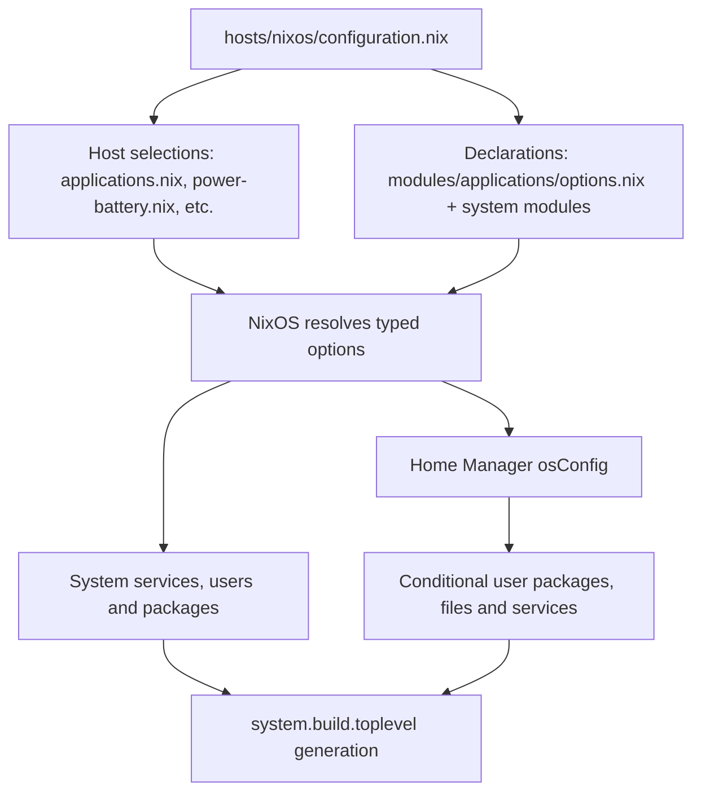

# Architecture and module reference

## Evaluation and activation

`flake.nix` constructs the original `ankurLaptop` with
`nixpkgs.lib.nixosSystem { system = "x86_64-linux"; ...; }`.
Its modules are the laptop configuration, Home Manager's NixOS integration,
and an inline integration module. The inline module uses global Nixpkgs and
per-user packages, imports Nixvim plus the power-menu module as HM shared modules,
and passes five locked editor-source inputs using `extraSpecialArgs`.
`home-manager.users.ankur` imports `home/ankur/home.nix`.

`homeConfigurations."ankur@garuda"` is a different output: it imports
`hosts/garuda/home.nix`, then two currently empty `modules/home` files. It does not
import the personal NixOS home or use `osConfig`. It is exported, so cannot be
called deleted/unused merely because it is minimal; actual activation history is
unknown. `modules/development.nix` uses an older `mySystem.development` namespace
and has no active import in this checkout; retain it as a legacy module.

Additional host directories are discovered by `lib/hosts.nix`. A directory must
contain `configuration.nix`; `nixos` and `installer-iso` are reserved and handled
explicitly by `flake.nix`. Generated hardware supplies `nixpkgs.hostPlatform`.
Additional hosts receive HM integration but a user home is created only for the
Hyprland machine profile. `hosts/garuda` has only `home.nix`, so is not accidentally
registered as NixOS. Templates have no active `configuration.nix`.

An import makes a module available to the evaluator. A custom option does
nothing until implementation reads it. For example,
`my.system.performanceTuning.memory.zram.enable` contributes `zramSwap.enable` and
`memoryPercent` only under `lib.mkIf cfg.enable`. The actual host sets both enables
and `zramPercent = 90`; the competing 50% value in `garuda-system-goodies.nix` is a
`mkDefault`, so 90 wins. `my.system.maintenance.fstrim.enable = false` contributes
no `services.fstrim.enable` definition; it does not cancel Garuda goodies' `true`.

Same scalar values can merge harmlessly (GameMode enabled in two places); different
normal-priority values conflict. Lists merge rather than replace. Distinct
submodules can each contribute fields. `mkIf` must guard configuration, not decide
imports from the eventual `config`, which can cause infinite recursion.

## Original laptop system modules

Paths below are relative to the repository. `H:` means a host selection under
`hosts/nixos/`; `S:` means shared implementation under `modules/system/`.
Each row's enable column gives the master option; individual child flags may also
be required. The table describes source configuration, not a live-machine test.

| Module / actual paths | Purpose and dependencies | Enable mechanism / scope | Packages or services; conflicts | Verify after activation |
| --- | --- | --- | --- | --- |
| `hosts/nixos/configuration.nix` | Root imports; boot, locale, user, kernel, baseline sound/network | Host-specific, always imported | systemd-boot, Linux 6.18, NetworkManager, PipeWire, CUPS, Fish, `nh`; contains personal Garuda mount | `hostname`; `findmnt /`; `systemctl --failed` |
| `hosts/nixos/hardware-configuration.nix` | Generated hardware, four Btrfs mounts and ESP | Host-specific, regenerate only for target hardware | UUIDs, `kvm-amd`, microcode; never copy to another PC | `findmnt -R / -o TARGET,SOURCE,FSTYPE,OPTIONS` |
| `hosts/nixos/gpu.nix`; `modules/hardware/nvidia-hybrid.nix` | AMD/Intel iGPU plus NVIDIA offload; needs two real bus IDs | `my.hardware.gpu.enable`; host values, reusable implementation | NVIDIA open kernel module, graphics + 32-bit, `nvidia-offload`; PRIME sync conflicts with offload | `nvidia-smi`; `command -v nvidia-offload` |
| `modules/hyprland.nix` | System compositor, UWSM, XWayland, lock PAM | Always imported on laptop; lock PAM follows desktop lock flags | Hyprland; generated Lua is managed separately | `hyprctl version`; `hyprctl configerrors` |
| `modules/applications/options.nix`; `hosts/nixos/applications.nix` | Most application/category switches | `my.apps.<category>.enable` and per-app flags | Declarations + selections, not package installation themselves | `nix eval --json .#nixosConfigurations.nixos.config.my.apps` |
| `modules/applications/docker.nix` | Privileged Docker integration | Development master and Docker switch; shared code names user `ankur` | Docker daemon and root-equivalent `docker` group | `systemctl status docker`; `id` |
| `hosts/nixos/{browsers,media,social,gaming}.nix` | Extra app option declarations and host defaults | `my.apps.{browsers,media,social,gaming}` | Steam/GameMode system integration; other apps installed by HM; overlapping categories | Evaluate `my.apps`; `gamemoded -t` |
| `hosts/nixos/garuda-extras.nix` | Power profiles; rejects TLP, auto-cpufreq, tuned | Direct host import, no custom master | PPD; forces CPU governor to `null`, which wins over optional fixed governor | `powerprofilesctl list`; `systemctl status power-profiles-daemon` |
| `hosts/nixos/garuda-system-goodies.nix` | Priority/interrupt helpers, storage and compressed swap | Direct host import; native option overrides or explicit import removal | irqbalance, Ananicy C++, GameMode without renice, fstrim, NVMe none, ZRAM defaults; optional module values may win | `systemctl status ananicy`; `zramctl`; `systemctl list-timers --all` |
| `hosts/nixos/garuda-terminal-goodies.nix` | Fish colors and lower-priority system Kitty palette | Direct host import; user palette wins | HM Fish init plus `/etc/xdg/kitty/kitty.conf`; removing does not remove other shell config | `fish -ic 'set fish_color_command'`; inspect Kitty config |
| `H:performance-tuning.nix`; `S:performance-tuning.nix` | ZRAM settings and optional diagnostics/tuning | `my.system.performanceTuning`; shared | ZRAM, perf-health, optional irqbalance/tools/earlyoom; low-swappiness conflicts with host's 180, earlyoom checks oomd | `zramctl`; `sysctl vm.swappiness`; `perf-health` if enabled |
| `H:power-battery.nix`; `S:power-battery.nix` | Opt-in power tools/backends; diagnostics currently enabled | `my.system.powerBattery`; shared, thermald assumes GPU vendor option exists | power-health, optional TLP/auto-cpufreq/PPD/thermald; backends must be exclusive | `power-health`; `systemctl is-active power-profiles-daemon tlp auto-cpufreq` |
| `hosts/nixos/btrfs-maintenance.nix` | Monthly root scrub, excludes Garuda filesystem | Direct host import, Btrfs-only | `services.btrfs.autoScrub`; do not schedule per subvolume | `systemctl list-timers --all`; `sudo btrfs scrub status /` |
| `H:maintenance.nix`; `S:maintenance.nix` | Diagnostics plus optional storage/firmware maintenance | `my.system.maintenance`; shared | nix-health enabled; optional fstrim/scrub/smartd/fwupd/store optimisation; disabled flag does not negate another provider | `nix-health`; `systemctl list-timers --all` |
| `H:networking.nix`; `S:networking.nix` | Network diagnostics, optional DNS/VPN/discovery | `my.system.networking`; shared, some features require NM | net-health, DNS/mtr/traceroute/iperf3/ethtool; optional Avahi opens mDNS; DNS changes may restart networking | `net-health`; `nmcli device status` |
| `H:audio-bluetooth.nix`; `S:audio-bluetooth.nix` | Blueman, diagnostics, optional codecs/JACK | `my.system.audioBluetooth`; requires existing PipeWire/Pulse compatibility and BlueZ | audio-bt-health, Blueman; no second PulseAudio server | `audio-bt-health`; `wpctl status` |
| `H:kde-cleanup.nix`; `S:kde-cleanup.nix` | Disable Plasma and PAM KWallet while retaining SDDM | `my.system.kdeCleanup`; shared | `mkForce false` Plasma/PAM; user wallet switch is separate | Evaluate `services.desktopManager.plasma6.enable`; `ls /run/current-system/sw/share/wayland-sessions` |
| `H:qt-appearance.nix`; `S:qt-appearance-options.nix` | Option declarations for HM Qt/Kvantum | `my.system.qtAppearance` plus appearance/theme flags; shared | HM implements Qt settings, not this declaration file | `printenv QT_QPA_PLATFORMTHEME`; inspect `~/.config/Kvantum` |
| `H:desktop-customization.nix`; `S:desktop-customization.nix` | Optional theme/tool declarations; HM implementation | `my.system.desktopCustomization`, currently off | No automatic appearance change; optional tools may duplicate already installed tools | Evaluate `my.system.desktopCustomization`; `command -v nwg-look` |
| `H:session-appearance.nix`; `S:session-appearance.nix`; `hosts/nixos/sddm-astronaut.nix` | Login theme, cursor, night-light switch | `my.system.sessionAppearance`; Astronaut is direct host import | Elegant still packaged; forced Astronaut theme wins; HM owns hyprsunset | Evaluate SDDM theme; `systemctl --user status hyprsunset` |
| `H:storage-filesystems.nix`; `S:storage-filesystems.nix` | Optional filesystem tools/removable integration, no mount declarations | `my.system.storageFilesystems`, currently off; shared | ntfs/exfat/btrfs/FUSE/etc.; optional UDisks/GVfs and HM udiskie; avoid competing automounters | `findmnt`; `systemctl status udisks2` if enabled |
| `H:printing-peripherals.nix`; `S:printing-peripherals.nix` | Additional CUPS/scanning/phone/USB integrations | `my.system.printingPeripherals`, currently off | Baseline CUPS remains independently enabled; scanner backends, ADB, Bolt opt in | `systemctl status cups`; `scanimage -L` if scanner tools enabled |
| `H:security-privacy.nix`; `S:security-privacy.nix` | Optional AppArmor/auditing/firewall/secret tools | `my.system.securityPrivacy`, currently off | System GPG agent could overlap HM agent; SSH hardening does not start SSH | Evaluate selected options; `systemctl --failed` |
| `H:virtualization.nix`; `S:virtualization.nix` | Podman/Distrobox/libvirtd/VM tools | `my.system.virtualization`, currently off; libvirtd group names `ankur` | Distrobox requires an engine; do not add another Docker owner | `systemctl status libvirtd`; `id` if enabled |
| `H:multi-host.nix`; `S:multi-host.nix`; `modules/system/nix-fleet.sh` | Read-only host list, ISO build, template help | `my.system.multiHost` and tools flags | `nix-fleet`, no flashing or activation; paths are personal defaults | `nix-fleet hosts`; `nix-fleet template` |
| `H:nixos-updates.nix`; `S:nixos-updates.nix`; `modules/system/nix-update-safe.sh` | Manual guarded input updates, build/switch/commit | `my.system.nixosUpdates`; tied to `nixos` host | nix-update-safe; clean Git required; FIMLoom, Nixpkgs and SmoothCursor protected | `nix-update-safe status` |
| `hosts/nixos/shell-fish.nix` | System Fish/login shell independently of HM | Direct host import | `users.users.ankur.shell`; HM desktop fish flag does not change login shell | `getent passwd ankur` |
| `hosts/nixos/dev-environments.nix`; `modules/development/dev-shells.nix`; `modules/development/nix-dev.sh` | Data-driven devShell outputs and nix-dev wrapper | Plain settings attrset, not a NixOS module option namespace | Language shells only; repo path is personal | `nix-dev list`; `nix develop .#cpp -c g++ --version` |

## Home Manager modules

Every `my.apps` flag below also needs the category master. All these files are
personal to the original laptop, even where their implementation could be
refactored for reuse. Many read NixOS-only `osConfig` and are not standalone HM modules.

| Actual path(s) under `home/ankur/` | Purpose, enable/dependencies | Packages/files/services and conflicts | Verification |
| --- | --- | --- | --- |
| `home.nix` | Entry point, identity, state version, imports | Welcome file; all personal modules | Evaluate `home-manager.users.ankur.home.username` |
| `applications/default.nix` | Imports all app implementations | No independent master; preserves option schema | Check imports with `rg 'imports' home/ankur/applications` |
| `applications/development.nix`; `git.nix` | `my.apps.development` compilers and tools; Git has its own enable | GCC/Clang/Python/Node etc.; personal Git identity; Nixvim can also supply tools | `command -v gcc git`; `git config --show-origin user.name` |
| `applications/development/direnv.nix`; `development-environments.nix` | Direnv/nix-direnv unconditional; helper uses plain dev settings | `nix-dev` and Fish integration; not controlled by development master | `direnv version`; `nix-dev list` |
| `applications/{browsers,internet,media,multimedia,social,gwenview}.nix` | Category-based user packages | Browser/media/Signal overlaps; Gwenview belongs to multimedia | Evaluate HM `home.packages`; `command -v vivaldi mpv` |
| `applications/desktop.nix` | Desktop packages controlled by flags | Kitty/Fish/Waybar/clipboard/audio/etc.; package installation alone is not service startup | `command -v kitty waybar` |
| `applications/gaming.nix` | gaming master and individual flags; offload helper also needs PRIME | MangoHud, `game-on-nvidia`; does not itself request GameMode | `command -v game-on-nvidia`; `mangohud --help` |
| `applications/system-tools.nix` | `my.apps.systemTools` | Monitors and Nix inspection; nvtop backend selected for NVIDIA or iGPU vendor | `command -v btop nvtop nvd` |
| `applications/utilities.nix`; `applications/office.nix` | Utility/office flags | Thunar/editors/downloaders/document tools; optional legacy productivity fallback is dormant | `command -v thunar libreoffice pdftotext` |
| `applications/academics.nix`; `applications/academics/matlab-launch.sh` | Academics flags | RStudio, FHS MATLAB launcher; licensed MATLAB must be installed separately | `command -v matlab rstudio`; `matlab -help` after licensing |
| `applications/security.nix`; `gpg.nix` | Security flags, GPG agent needs its separate flag | GnuPG/pass, user gpg-agent with Qt pinentry; avoid second system agent owner | `gpgconf --list-dirs`; `systemctl --user status gpg-agent` |
| `fish.nix`; `shell/default.nix`; `shell/starship.toml`; `shell/fastfetch/config.jsonc` | Desktop/Fish flags | Fish abbreviations/aliases, Starship and Fastfetch; host login shell remains Fish independently | `fish -ic 'abbr; alias'`; `starship --version` |
| `fonts.nix`; `theme.nix`; `themes/` | Appearance master plus fonts/theme switches | Nerd fonts, Sweet-Dark GTK, BeautyLine, Sweet cursors; assets are repository files | `fc-match monospace`; inspect GTK files |
| `qt-appearance.nix`; `desktop-customization.nix` | Corresponding `my.system` switches; Qt also needs theme | Qt5ct/Qt6ct/Kvantum Sweet, optional GUI tools; GUI editors cannot permanently edit HM symlinks | Inspect generated Qt/Kvantum config; relogin |
| `kde-cleanup.nix`; `audio-bluetooth.nix`; `storage-filesystems.nix` | Corresponding system master and child flags | Optional kwalletrc, Blueman applet, udiskie; system services are dependencies | `systemctl --user status blueman-applet udiskie` when enabled |
| `trash-cleanup.nix` | Unconditional existing import | trash-cli and daily user timer permanently delete trash older than 30 days | `systemctl --user list-timers --all`; `systemctl --user cat trash-cleanup` |
| `zellij.nix`; `zellij/config.kdl` | Desktop/Zellij flags | HM program plus raw multiplexer config | `zellij --version` |
| `hyprland/default.nix`; `hyprland/hyprland.lua` | Lua always generated; Nix prefixes `app_enabled` flags | Filtered autostarts/bindings; laptop scale and paths remain personal | `hyprctl configerrors`; `rg app_enabled ~/.config/hypr/hyprland.lua` |
| `hyprland/waybar.nix`; `hyprland/waybar/{config.json,style.css,scripts/}` | Desktop/Waybar; individual component flags | Generates `waybar/config` from JSON; `wlo1`, PPD controls, filtered Pacman updater; legacy raw `waybar/config` is not the active source | `jq . ~/.config/waybar/config`; run `waybar` from a TTY/debug shell |
| `hyprland/kitty.nix`; `hyprland/kitty/kitty.conf` | Desktop/Kitty flags | HM writes personal Kitty config, strips `shell fish` when HM Fish off; user colors override system palette | `kitty --debug-config` on versions supporting it; inspect config |
| `hyprland/{wofi,mako,hyprlock,hypridle,drawer}.nix` and matching asset directories | Corresponding desktop flags | Config files only; Lua starts Mako/idle, system PAM supports hyprlock | Inspect files; `pgrep -a 'mako|hypridle'` |
| `hyprland/hyprsunset.nix` | sessionAppearance master + hyprsunset | HM user service, schedules 07:30/19:00 | `systemctl --user status hyprsunset` |
| `hyprland/nwg-bar.nix` | HM shared module; desktop/powerMenu guard | nwg-bar + generated menu/style; commands use lock/suspend/logout/reboot/poweroff | `nwg-bar -t test.json` (notification-only test menu) |
| `hyprland/wpaperd/config.toml`; `hyprland/dock/style.css` | Wallpaper/dock flags | Personal wallpaper folder `/home/ankur/custom_wallpapers/photos` is not in Git | Check folder exists; `pgrep -a wpaperd` |
| `applications/neovim/default.nix` | Development/Neovim; requires Nixvim shared module and five source args | Nixvim entry point, optional FIMLoom (default off), pinned cursor/minimap plugins | `nvim --headless '+checkhealth' +qa` (inspect output) |
| `applications/neovim/{options,keymaps,theme}.nix` | Imported under active Nixvim | Editor settings, keybindings and Cyberdream/highlights | `nvim`; inspect `:set` and `:map` |
| `applications/neovim/{plugins,lsp,completion}.nix` | Same | Native plugin config, Nix-managed LSP, nvim-cmp/LuaSnip; no Mason downloads | `:checkhealth`; `:LspInfo` |
| `applications/neovim/{dashboard,statusline,snippets,webdev-extras}.nix` | Same; Emmet/React sources passed explicitly | Alpha, Eviline, friendly snippets, Emmet/React integration | Open dashboard, snippets and a supported code file |

`home/ankur/Building` is an empty tracked file, not a module. Raw desktop assets and
`waybar/config` are retained; only paths actually referenced by modules activate.
`hyprland/waybar/scripts/OCV` is an executable calendar helper.

## Additional-host and installer modules

| Path | Responsibility / activation | Dependencies, limitations and verification |
| --- | --- | --- |
| `lib/hosts.nix` | Automatically exports directories with configuration.nix | Nixpkgs/HM inputs; new paths must be Git-added; `nix eval --json .#nixosConfigurations --apply builtins.attrNames` |
| `modules/profiles/portable.nix` | `my.profiles.portable`, opt-in basic packages | No hardware/boot/user opinion; used by machine profile |
| `modules/profiles/machine.nix` | `my.machine` new-host profile | Explicit username, desktop and graphics; adds NVIDIA only for NVIDIA enum selections; no personal laptop modules |
| `hosts/templates/new-host.nix.example` | Inactive reference | Must provide hardware file and boot policy; generator preferred |
| `hosts/installer-iso/default.nix`; `modules/iso/installer-features.nix` | Independent upstream minimal installer + selectable tools | `my.iso.features`; build `.#nixosConfigurations.ankur-installer-iso.config.system.build.isoImage`; not a disk clone |
| `scripts/{install.sh,new-host.sh,nixos_tools.py}` | General install and host generation | Python 3; installer uses NixOS live tools and typed local confirmations; no partitioning/formatting implementation |
| `scripts/reinstall-nixos/` | Historical fixed-device mount/install/GRUB tools | Original laptop only; preserve specialized workflow, never invoke automatically on a new host |
| `tests/`, `scripts/check.sh` | Safety tests, syntax, optional evaluation | Simulated tests do not establish hardware boot success |

## Known boundaries

Many older shared modules still name `ankur` or read `hosts/nixos/dev-environments.nix`.
They are reusable within the original architecture, not automatically portable.
The new machine profile provides a clean base; parameterize usernames and replace
host-data imports before reusing those older modules. Check
`rg 'ankur|hosts/nixos|wlo1|/mnt/garuda' MODULE` first.
No input pins, original disk UUIDs, keybinding commands, driver packages, ZRAM
values or existing Btrfs scrub targets were changed by the documentation work;
the power-menu binding now follows its existing enable switch.
